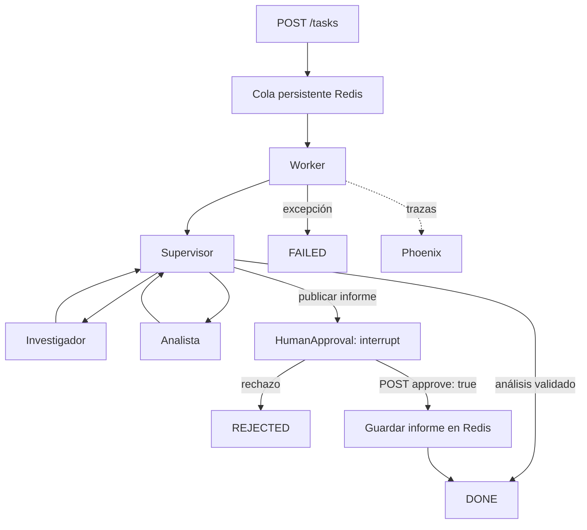

# Preentrega 7: API de producción y monitoreo activo

API FastAPI del orquestador del módulo 6: supervisor, investigador SQLite y analista de ventanas de tokens. La API encola las tareas en Redis y responde `202` con un `job_id`. El worker ejecuta el grafo sin ocupar el endpoint y guarda estados, resultados y checkpoints en Redis.



## Iniciar localmente

Python 3.12+, Redis estándar y Ollama. La configuración usada se probó en macOS con Redis 8.10; el checkpointer propio `AsyncRedisSaver` usa claves, hashes y conjuntos ordenados, sin exigir RedisJSON ni Redis Search. Guarda checkpoints completos, metadatos, parentesco y escrituras pendientes. La prueba de integración verifica una reanudación desde una instancia nueva de la API.

```bash
python -m venv .venv
source .venv/bin/activate
pip install -r requirements.txt
cp .env.example .env
mkdir -p .runtime/redis .runtime/phoenix
ollama pull llama3.1
```

Levantar estos procesos en terminales separadas desde el repositorio:

```bash
redis-server --bind 127.0.0.1 --port 6387 --dir "$PWD/.runtime/redis" --appendonly yes
```

```bash
ollama serve
```

```bash
PHOENIX_WORKING_DIR="$PWD/.runtime/phoenix" PHOENIX_HOST=127.0.0.1 PHOENIX_PORT=6007 phoenix serve
```

```bash
uvicorn app.main:app --host 127.0.0.1 --port 8007
```

API y documentación interactiva: `http://127.0.0.1:8007/docs`. Phoenix: `http://127.0.0.1:6007`. El encabezado `X-API-Key` usa `API_TOKEN`; `local-demo` es solo la clave del entorno local y debe cambiarse si se despliega.

## Cinco peticiones concurrentes y monitoreo

Antes de ejecutar la carga, en Phoenix → Settings → Models, agregar el modelo `Llama 3.1 local`, patrón `^llama3\.1(:latest)?$`, con entrada y salida a **USD 0 por millón de tokens**. Corresponde al costo de API de la inferencia local, sin incluir electricidad ni hardware. Phoenix calcula el costo de cada traza a partir de los tokens reales y esa tarifa.

```bash
python scripts/load_test.py
```

El script usa `asyncio.gather` para enviar cinco solicitudes, consulta sus estados y guarda `load_results.json`. `WORKERS=1` limita las inferencias simultáneas para el modelo local; las cinco peticiones HTTP se aceptan concurrentemente y su trabajo queda encolado.

En el proyecto `preentrega7-carga5-final`, revisar las trazas del worker, los nodos, las herramientas y los spans LLM. El panel Metrics muestra la latencia p95; la tabla de trazas muestra el costo por ejecución. Las capturas de esa corrida están en `screenshots/`. Se instrumenta el trabajo completo, sin incluir las consultas HTTP de estado en ese proyecto. El p95 de Phoenix corresponde a la ejecución del trabajo, no al tiempo de aceptación HTTP ni a la espera previa en la cola.

## Aprobación humana

`action="publish_report"` identifica una operación con efecto secundario: publicar el informe en Redis. El grafo calcula el resultado y se detiene obligatoriamente antes de publicar. No se crea el informe hasta recibir una aprobación externa; el checkpoint permite esperar incluso si se reinicia la API.

```bash
curl -X POST http://127.0.0.1:8007/tasks \
  -H 'X-API-Key: local-demo' -H 'Content-Type: application/json' \
  -d '{"request":"Investigar chunking: 2000 tokens, fragmentos de 500 y solapamiento 50","action":"publish_report"}'
```

Consultar `GET /tasks/{job_id}` hasta `WAITING_APPROVAL`. Luego:

```bash
curl -X POST http://127.0.0.1:8007/tasks/JOB_ID/approve \
  -H 'X-API-Key: local-demo' -H 'Content-Type: application/json' \
  -d '{"approved":true}'
```

`false` deja el trabajo en `REJECTED` y no publica. `GET /tasks/{job_id}/report` devuelve el informe únicamente después de aprobar. Los errores del worker quedan en `FAILED` con su motivo.

## Pruebas y recuperación

```bash
TRACING_ENABLED=false pytest -q
```

Las pruebas usan Redis real y un modelo controlado para comprobar encolado, persistencia de checkpoints, reinicio durante la pausa, aprobación, rechazo, errores y validación HTTP. `load_results.json` y las capturas corresponden a inferencias reales de Ollama.

Al reiniciar una única instancia de la API, las tareas que estaban en `processing` vuelven a la cola y retoman su checkpoint. Las que esperan aprobación conservan ese estado. Se usa una sola instancia del servicio; `WORKERS` controla la concurrencia interna.

## Docker Compose opcional

`docker compose up --build` levanta Redis, Phoenix y la API. Ollama debe estar ejecutándose en el host y accesible desde Docker mediante `host.docker.internal`. La ejecución verificada de esta entrega es la local indicada arriba.
